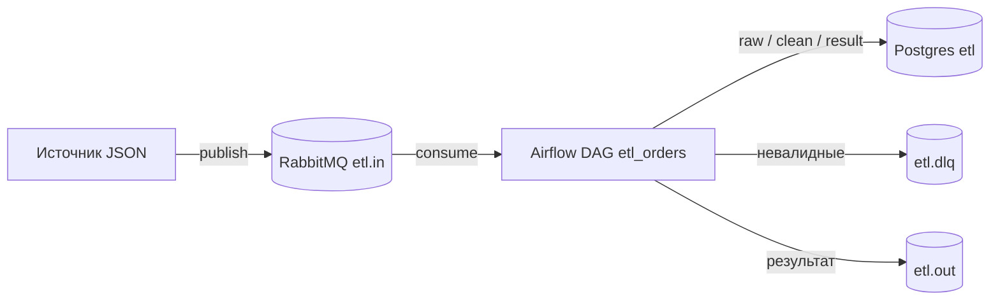

# План проекта: ETL-конвейер в Docker

Учебный проект. Цель: создать етл конвейр.
Репозиторий: lelik-bolek/etlpipelinedockertestboard (приватный). Дата плана: 2026-11-08.

## 1. Что строим



Сообщение JSON о заказе приходит в `etl.in`. DAG `etl_orders` раз в минуту читает пачку, пишет в Postgres, считает итог заказа и публикует результат в `etl.out`. Невалидные сообщения уходят в `etl.dlq`.

Внутри DAG четыре задачи по порядку: `consume` → `validate` → `transform` → `publish`. Состояние каждого сообщения хранится в `raw.messages.status` (`new` → `valid`/`invalid` → `processed` → `published`), поэтому шаги можно безопасно перезапускать.

## 2. Принятые решения

| Что | Решение |
|---|---|
| Postgres | образ `postgres:17`; две БД: `etl` (данные), `airflow` (метаданные Airflow) |
| RabbitMQ | образ `rabbitmq:4-management`; vhost `/`; очереди `etl.in`, `etl.out`, `etl.dlq`, все durable |
| Airflow | `apache/airflow:3.3.2` (3.4.0 вышел 6.11.2026, взята предыдущая проверенная), LocalExecutor, свой образ + `pika`, `jsonschema` |
| Airflow 3 | импорты только из `airflow.sdk` (`dag`, `task`); пути Airflow 2 не использовать |
| Доставка | at-least-once; дубли гасятся по `dedup_key` (raw) и `order_id` (clean/result) |
| Скрипты на хосте | только стандартная библиотека Python 3 (`urllib`, `subprocess`, `json`), без установки пакетов; запускаются `python3 scripts/...` |
| Доступ к RabbitMQ с хоста | через management HTTP API на `127.0.0.1:15672` |
| Порты | только на `127.0.0.1`: Postgres 5433, RabbitMQ 5672 и 15672, Airflow UI 8080 |
| Секреты | пароли только в `.env` (не в git); в `.env.example` заглушки |
| Теги образов | всегда конкретные, `latest` запрещён |

## 3. Формат сообщений

Вход (`etl.in`), одно сообщение — один заказ:

```json
{
  "message_id": "00000000-0000-4000-8000-000000000001",
  "event_type": "order_created",
  "occurred_at": "2026-11-08T12:00:00Z",
  "payload": {
    "order_id": 1001,
    "customer_id": "C-001",
    "currency": "EUR",
    "items": [
      {"sku": "A-1", "qty": 2, "price": 10.50},
      {"sku": "B-7", "qty": 1, "price": 5.00}
    ]
  }
}
```

Правила схемы: все поля обязательны, лишних полей нет; `event_type` только `order_created`; `occurred_at` — date-time; `order_id` целое ≥ 1; `customer_id` непустая строка; `currency` одно из `EUR`, `USD`, `RUB`; `items` не пустой массив; `qty` целое ≥ 1; `price` число ≥ 0.

Выход (`etl.out`):

```json
{"message_id": "...", "order_id": 1001, "customer_id": "C-001", "currency": "EUR", "items_count": 2, "total": 26.00, "processed_at": "2026-11-08T12:01:03Z"}
```

`items_count` — число строк заказа, `total` — сумма `qty * price`. Считать только в SQL (`numeric`), не в `float`. JSON для `etl.out` формировать в SQL (`json_build_object`), чтобы не потерять точность.

Невалидные (`etl.dlq`): тело сообщения без изменений, в заголовке сообщения `x-error` с короткой причиной.
