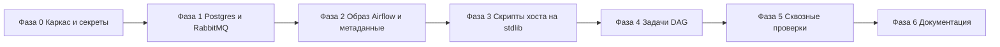

# Дорожная карта: ETL-конвейер в Docker

Источник требований: [`docs/PLAN.md`](PLAN.md). Репозиторий на момент составления содержит только `README.md` и `docs/PLAN.md`, поэтому карта описывает создание проекта с нуля.

Правила карты:
- один шаг = одно действие с одним артефактом;
- шаг считается выполненным только при выполнении команды проверки;
- шаги выполняются строго по порядку внутри фазы; фазы 0 → 6 последовательны.

## Фаза 0. Каркас репозитория и секреты

- [ ] **0.1** Создать `.gitignore`: `.env`, `__pycache__/`, `*.py[cod]`, `logs/`, `.venv/`, `.DS_Store`.
  - Готово: `.env` не попадает в индекс git.
  - Проверка: после шага 0.3 команда `git status --short` не показывает `.env`.
- [ ] **0.2** Создать `.env.example` с заглушками ключей: `POSTGRES_USER`, `POSTGRES_PASSWORD`, `RABBITMQ_DEFAULT_USER`, `RABBITMQ_DEFAULT_PASS`, `AIRFLOW_ADMIN_USER`, `AIRFLOW_ADMIN_PASSWORD`, `AIRFLOW_FERNET_KEY`, `AIRFLOW_SECRET_KEY`.
  - Готово: перечисленные ключи присутствуют, значений-секретов нет.
  - Проверка: `grep -o '^[A-Z_]*' .env.example | sort -u` совпадает со списком ключей, используемых в `docker-compose.yaml`.
- [ ] **0.3** Создать локальный `.env` на основе `.env.example` с реальными значениями.
  - Готово: файл существует, содержит все ключи.
  - Проверка: `test -f .env && echo ok`.
- [ ] **0.4** Создать каталоги `airflow/dags/`, `postgres/init/`, `scripts/`.
  - Готово: три каталога существуют.
  - Проверка: `ls -d airflow/dags postgres/init scripts`.

## Фаза 1. Postgres и RabbitMQ

- [ ] **1.1** Добавить в `docker-compose.yaml` сервис `postgres`: образ `postgres:17`, порт `127.0.0.1:5433:5432`, именованный volume, переменные из `.env`, healthcheck `pg_isready`.
  - Готово: compose валиден, контейнер здоров.
  - Проверка: `docker compose config -q` без вывода; `docker compose up -d postgres && docker compose ps postgres` → статус `healthy`.
- [ ] **1.2** Создать `postgres/init/01_databases.sh` — идемпотентное создание БД `etl` и `airflow`.
  - Готово: обе базы создаются при инициализации тома.
  - Проверка: `docker compose exec postgres psql -U "$POSTGRES_USER" -tAc "select datname from pg_database"` содержит `etl` и `airflow`.
- [ ] **1.3** Создать `postgres/init/02_raw_schema.sql`: схема `raw`, таблица `raw.messages` с `dedup_key` unique, `payload jsonb`, `status`, `error`, метками времени.
  - Готово: таблица создана с ограничением уникальности.
  - Проверка: `docker compose exec postgres psql -U "$POSTGRES_USER" -d etl -c "\d raw.messages"` — в выводе есть `unique` по `dedup_key`.
- [ ] **1.4** Создать `postgres/init/03_clean_schema.sql`: `clean.orders` и `clean.order_items`, поля `qty` и `price` типа `numeric`.
  - Готово: обе таблицы созданы, связь по `order_id`.
  - Проверка: `docker compose exec postgres psql -U "$POSTGRES_USER" -d etl -c "\d clean.order_items"` — типы `numeric`, есть FK.
- [ ] **1.5** Создать `postgres/init/04_result_schema.sql`: `result.order_totals` с `items_count`, `total numeric`, `processed_at`.
  - Готово: таблица создана, `order_id` первичный ключ.
  - Проверка: `docker compose exec postgres psql -U "$POSTGRES_USER" -d etl -c "\d result.order_totals"`.
- [ ] **1.6** Добавить в `docker-compose.yaml` сервис `rabbitmq`: образ `rabbitmq:4-management`, порты `127.0.0.1:5672` и `127.0.0.1:15672`, volume, healthcheck `rabbitmq-diagnostics -q ping`.
  - Готово: контейнер здоров, API отвечает.
  - Проверка: `docker compose up -d rabbitmq`, затем `curl -su "$RABBITMQ_DEFAULT_USER:$RABBITMQ_DEFAULT_PASS" http://127.0.0.1:15672/api/overview` → HTTP 200.
- [ ] **1.7** Создать `scripts/declare_queues.py`: объявление durable-очередей `etl.in`, `etl.out`, `etl.dlq` через management API.
  - Готово: скрипт идемпотентен, повторный запуск не даёт ошибок.
  - Проверка: `python3 scripts/declare_queues.py && curl -su "$RABBITMQ_DEFAULT_USER:$RABBITMQ_DEFAULT_PASS" http://127.0.0.1:15672/api/queues/%2F` содержит все три имени.
- [ ] **1.8** Проверить отсутствие тега `latest` в образах.
  - Готово: все образы с конкретными тегами.
  - Проверка: `grep -n 'image:' docker-compose.yaml` — ни одной строки с `latest`.

## Фаза 2. Образ Airflow и метаданные

- [ ] **2.1** Создать `airflow/requirements.txt` с точными версиями `pika` и `jsonschema`.
  - Готово: обе зависимости зафиксированы.
  - Проверка: `grep -c '==' airflow/requirements.txt` → `2`.
- [ ] **2.2** Создать `airflow/Dockerfile`: `FROM apache/airflow:3.3.2`, установка требований.
  - Готово: образ собирается без ошибок.
  - Проверка: `docker compose build airflow` завершается с кодом 0.
- [ ] **2.3** Добавить в `docker-compose.yaml` сервис `airflow`: build из `airflow/`, LocalExecutor, подключение к БД `airflow`, `FERNET_KEY` и `SECRET_KEY` из `.env`, порт `127.0.0.1:8080`, volume `./airflow/dags`, зависимость от здорового postgres.
  - Готово: сервис стартует и здоров.
  - Проверка: `docker compose up -d airflow && docker compose ps airflow` → `healthy`; `curl -s -o /dev/null -w '%{http_code}' http://127.0.0.1:8080` → `200`.
- [ ] **2.4** Инициализировать метаданные Airflow и учётную запись администратора из `.env`.
  - Готово: метаданные мигрированы, вход в UI работает.
  - Проверка: `docker compose exec airflow airflow dags list` завершается без ошибок; вход в UI под `AIRFLOW_ADMIN_USER`/`AIRFLOW_ADMIN_PASSWORD` успешен.
- [ ] **2.5** Создать каркас `airflow/dags/etl_orders.py`: импорты только из `airflow.sdk`, DAG `etl_orders`, расписание раз в минуту.
  - Готово: DAG виден планировщику без ошибок импорта.
  - Проверка: `docker compose exec airflow airflow dags list | grep etl_orders`; в `docker compose logs airflow` нет `ImportError`.

## Фаза 3. Скрипты хоста на стандартной библиотеке

- [ ] **3.1** Создать `scripts/rmq.py`: клиент management API на `urllib` с basic auth, функции публикации и чтения.
  - Готово: модуль импортируется и проходит самопроверку.
  - Проверка: `python3 scripts/rmq.py --check` печатает `ok`, код возврата 0.
- [ ] **3.2** Создать `scripts/publish_order.py` с параметром `--scenario valid|invalid`, публикующий сообщение в `etl.in` по формату раздела 3 `PLAN.md`.
  - Готово: оба сценария публикуют по одному сообщению.
  - Проверка: `python3 scripts/publish_order.py --scenario valid`, затем `curl -su "$RABBITMQ_DEFAULT_USER:$RABBITMQ_DEFAULT_PASS" http://127.0.0.1:15672/api/queues/%2F/etl.in` → `messages: 1`.
- [ ] **3.3** Создать `scripts/read_queue.py` с параметром `--queue`, читающий сообщения с подтверждением.
  - Готово: выводит тело и заголовки сообщения.
  - Проверка: `python3 scripts/read_queue.py --queue etl.out` завершается с кодом 0 и печатает JSON.
- [ ] **3.4** Создать `scripts/check_stack.py`: проверка Postgres, RabbitMQ, Airflow и наличия трёх очередей.
  - Готово: отчёт по каждому компоненту.
  - Проверка: `python3 scripts/check_stack.py` — все пункты `ok`, код возврата 0.

## Фаза 4. Задачи DAG `etl_orders`

- [ ] **4.1** Реализовать задачу `consume`: чтение пачки из `etl.in`, вставка в `raw.messages` с `ON CONFLICT (dedup_key) DO NOTHING`, подтверждение после записи.
  - Готово: сообщения попадают в `raw.messages`, повторы не создают строк.
  - Проверка: `docker compose exec airflow airflow tasks test etl_orders consume 2026-11-08`, затем `psql -c "select count(*) from raw.messages"` — число растёт, повторный запуск его не меняет.
- [ ] **4.2** Реализовать задачу `validate`: проверка по правилам раздела 3 `PLAN.md` через `jsonschema`, статусы `valid`/`invalid`, отправка невалидных в `etl.dlq` с заголовком `x-error`.
  - Готово: валидные получают `valid`, невалидные — `invalid` и попадают в DLQ.
  - Проверка: `psql -c "select status, count(*) from raw.messages group by 1"`; `python3 scripts/read_queue.py --queue etl.dlq` показывает сообщение с `x-error`.
- [ ] **4.3** Реализовать задачу `transform`: расчёт `items_count` и `total` в SQL с `numeric`, запись в `clean.orders`, `clean.order_items`, `result.order_totals`, статус `processed`.
  - Готово: итоги совпадают с ожидаемыми для тестового заказа, точность не теряется.
  - Проверка: `psql -c "select order_id, items_count, total from result.order_totals"` — `items_count = 2`, `total = 26.00` для заказа из примера `PLAN.md`.
- [ ] **4.4** Реализовать задачу `publish`: формирование JSON через `json_build_object` из `result.order_totals`, публикация в `etl.out`, статус `published`.
  - Готово: сообщение в `etl.out` соответствует формату выхода.
  - Проверка: `python3 scripts/read_queue.py --queue etl.out` — поля `order_id`, `items_count`, `total`, `processed_at` присутствуют.
- [ ] **4.5** Связать задачи цепочкой `consume >> validate >> transform >> publish`.
  - Готово: в DAG ровно четыре задачи в линейном порядке.
  - Проверка: `docker compose exec airflow airflow tasks list etl_orders` — четыре задачи; `airflow dags show etl_orders` — линейный граф.

## Фаза 5. Сквозные проверки

- [ ] **5.1** Прогнать валидный заказ от публикации до результата.
  - Готово: результат появляется в `etl.out` за один-два цикла расписания.
  - Проверка: `python3 scripts/publish_order.py --scenario valid`, затем `python3 scripts/read_queue.py --queue etl.out` — корректный `total`, в `raw.messages` статус `published`.
- [ ] **5.2** Прогнать невалидный заказ.
  - Готово: сообщение уходит в DLQ, в `raw.messages` статус `invalid`.
  - Проверка: `python3 scripts/publish_order.py --scenario invalid`, затем `python3 scripts/read_queue.py --queue etl.dlq` — тело без изменений, есть `x-error`.
- [ ] **5.3** Проверить дедупликацию по `dedup_key` и `order_id`.
  - Готово: повторная публикация того же `message_id` не создаёт новых строк.
  - Проверка: повторный `publish_order.py --scenario valid`; `psql -c "select count(*) from raw.messages where dedup_key = '<id>'"` → `1`, в `clean` и `result` по одной строке.
- [ ] **5.4** Проверить идемпотентность перезапуска задач.
  - Готово: повторный запуск `transform` не меняет итоги.
  - Проверка: очистка и повторный запуск `transform` для того же интервала; `select items_count, total from result.order_totals` не изменились.
- [ ] **5.5** Проверить сохранность данных при перезапуске стека.
  - Готово: данные Postgres и сообщения в очередях сохраняются.
  - Проверка: `docker compose down && docker compose up -d`, затем `python3 scripts/check_stack.py` → все `ok`, данные на месте.

## Фаза 6. Документация

- [ ] **6.1** Заполнить `README.md`: назначение проекта, схема потока, порты, порядок запуска, команды проверки.
  - Готово: инструкция воспроизводится на чистом клоне.
  - Проверка: шаги из README выполняются подряд без правок.
- [ ] **6.2** Добавить в `README.md` раздел «Диагностика»: недоступный сокет Docker, занятые порты, отсутствие `.env`.
  - Готово: каждый пункт содержит симптом и действие.
  - Проверка: `grep -n 'Диагностика' README.md` находит раздел, в нём не менее трёх пунктов.
- [ ] **6.3** Обновить `docs/ROADMAP.md`: отметить выполненные шаги.
  - Готово: карта соответствует фактическому состоянию репозитория.
  - Проверка: для каждого отмеченного шага команда проверки выполнена и её результат зафиксирован.

## Допущения и неизвестное

- Точные команды Airflow 3 для миграции метаданных и создания администратора (`airflow db migrate`, `airflow users create`) сверяются с образом `apache/airflow:3.3.2` на шаге 2.4; при расхождении шаг уточняется до выполнения.
- Очереди объявляются скриптом через management API (шаг 1.7), файл `definitions.json` не используется.
- В `PLAN.md` не детализированы имена и состав таблиц `raw`, `clean`, `result`; они фиксируются на шагах 1.3–1.5 и далее не меняются.
- Способ инициализации БД `airflow` (шаг 1.2) зависит от того, создаёт ли образ Airflow базу сам; при автоматическом создании шаг сводится к проверке наличия БД.
- Размер пачки сообщений в задаче `consume` в `PLAN.md` не задан; принимается значение 100 и фиксируется в коде DAG.
